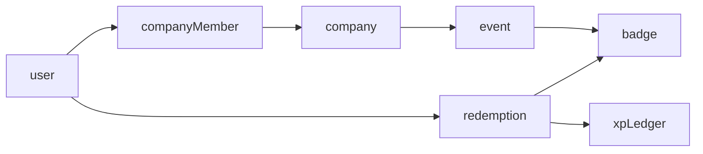

# Lyfter Badge App

Plataforma mobile-first para eventos de Lyfter. Un participante hace check-in, canjea badges con QR, suma XP y puede compartir el badge que obtuvo. Cada empresa administra sus eventos. Un super admin opera la plataforma y entra a una empresa por impersonación.

Tres roles:

- **Participante.** Ve su colección, su nivel y el ranking. Comparte un badge con un link público.
- **Admin de empresa.** Crea eventos y badges, muestra los QR y sube fotos del evento.
- **Super admin.** Crea empresas, asigna admins, mira usuarios y la auditoría. Entra al panel de una empresa impersonándola.

## Requisitos

- Node.js 24
- pnpm 11+
- Docker, para el Postgres local

## Desarrollo local

```
cp .env.example .env
docker compose up -d
pnpm install
pnpm db:migrate
pnpm db:seed
pnpm db:seed:dev
pnpm dev
```

Abrí http://localhost:3000.

El contenedor crea dos bases en `localhost:5433`: `lyfter_dev` (la de `.env`, para `pnpm dev`) y `lyfter_test` (la de `.env.test`, para `pnpm test`). La base de Railway es producción: solo la usan Vercel y el deploy de GitHub Actions.

`pnpm test` migra `lyfter_test` antes de correr y se niega a arrancar si `DATABASE_URL` no apunta a `localhost`. Para empezar de cero: `docker compose down -v && docker compose up -d`.

## Variables

En `.env`, para local:

- `DATABASE_URL` apunta a `lyfter_dev`.
- `BETTER_AUTH_SECRET` y `BETTER_AUTH_URL` arman la sesión. La URL también es la base del link para compartir.
- `QR_SECRET` firma los QR. Cambiarlo invalida los QR que están en pantalla.
- `BLOB_READ_WRITE_TOKEN` sube las fotos del evento. Sin token, subir muestra un error y no escribe la fila. En producción vive en Vercel, no como secret de GitHub Actions.
- `SUPER_ADMIN_EMAIL` y `SUPER_ADMIN_PASSWORD` los usa `pnpm db:seed`. Si el email ya existe, solo garantiza el rol; no pisa la contraseña.

Solo en el environment `production` de GitHub: `PROD_DATABASE_URL` y `VERCEL_TOKEN`. El resto de los secretos de runtime está en Vercel.

## Datos de demo

`pnpm db:seed:dev` es idempotente y se niega fuera de localhost. Crea la empresa **Lyfter Demo** con Demo Day activo (se reabre 30 días en cada corrida), Hackathon en borrador y Kickoff finalizado. La contraseña de las dos cuentas es `lyfter-dev-1234`.

- `admin@demo.test`: admin de Lyfter Demo.
- `participante@demo.test`: con check-in y dos badges canjeados (150 XP, nivel 2). Si escanea **Stand de datos** llega a 200 XP y ve el aviso de subida al nivel 3.

## Decisiones que el enunciado dejaba abiertas

- Completar un evento exige los badges marcados como requeridos. Los opcionales suman XP y no bloquean el premio.
- Escanear un badge sin check-in previo anota la asistencia en la misma transacción. El QR de bienvenida es el del evento, no un tipo de badge.
- La rareza es `COMMON`, `RARE`, `EPIC` o `LEGENDARY`.
- El QR de badge y el de check-in rotan cada 30 segundos. No se guardan tokens.
- El link público muestra nombre, badge, evento y el XP de ese badge. No muestra el email, el XP total ni las fotos.

## Datos

`pnpm db:migrate` aplica, en orden, los SQL de `db/migrations`. No se edita una migración ya aplicada: el cambio siguiente es una migración nueva (`pnpm db:generate`).



`user` es la cuenta. `company_member` une una cuenta con una empresa. `event` pertenece a una empresa y tiene país y modalidad. `badge` pertenece a un evento. `badge_redemption` es el canje de un usuario, y de ahí sale una fila de `xp_ledger`.

## Deploy

En cada pull request y en cada push a `main`, GitHub Actions corre las migraciones desde cero, el lint y los tests contra un Postgres efímero. Un push a `main` que pasa los tests migra la base de Railway y después despliega a Vercel. El código nuevo no arranca contra un schema viejo.

Las migraciones tienen que poder convivir con la versión que todavía está en producción mientras corre el deploy.
